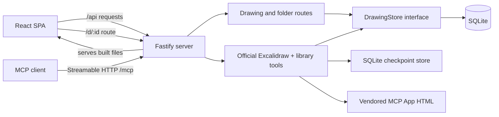

# Architecture

Excalistack is a self-hosted Excalidraw library. The browser UI talks to a single Fastify server; drawings and folders are persisted in SQLite. The server can also serve the production SPA and optionally expose an MCP endpoint.

## Packages

| Path              | Responsibility                                                                                                     |
| ----------------- | ------------------------------------------------------------------------------------------------------------------ |
| `apps/web`        | React/Vite dashboard and Excalidraw editor. Uses the REST API for library operations and autosaves editor changes. |
| `apps/server`     | Fastify API, SQLite persistence, static SPA hosting, and optional MCP server.                                      |
| `packages/shared` | Domain types, Zod validation schemas, and Excalidraw document helpers shared by the web app and server.            |

## Runtime request flow

The browser uses the same server for the REST API and, in production, the built SPA. During development, Vite serves the SPA and proxies `/api` to the server.

## Persistence

`apps/server/src/db.ts` opens SQLite with WAL journaling and applies idempotent schema setup. `apps/server/src/store.ts` defines the `DrawingStore` contract and its `SqliteDrawingStore` implementation. Routes depend on that contract rather than issuing SQL directly.

Drawings store scene elements, the persisted subset of Excalidraw app state, and embedded files as JSON. Folder rows support nesting; a default `Drafts` folder is created and legacy drawings are backfilled into it. MCP checkpoints are stored separately in SQLite, capped at 100 retained checkpoints and 5 MB per checkpoint.

## Build and deployment

The workspace build compiles shared code, the server, and the web app. The production server serves `apps/web/dist` (or the configured `WEB_DIST_DIR`) and uses the configured `DATA_DIR` for SQLite files. Docker builds and deploys the server and web bundle together. See the [root README](../README.md) for commands, environment variables, and backup/restore instructions.

## Optional MCP integration

MCP is opt-in via `MCP_ENABLED=true`. When enabled, `/mcp` mounts a stateless Streamable HTTP transport. Official Excalidraw visualization tools and Excalistack library tools share the same `DrawingStore` and SQLite database. The widget HTML is vendored under `apps/server/src/mcp/vendor`; see [MCP](mcp.md) and [MCP widget](mcp-widget.md).
